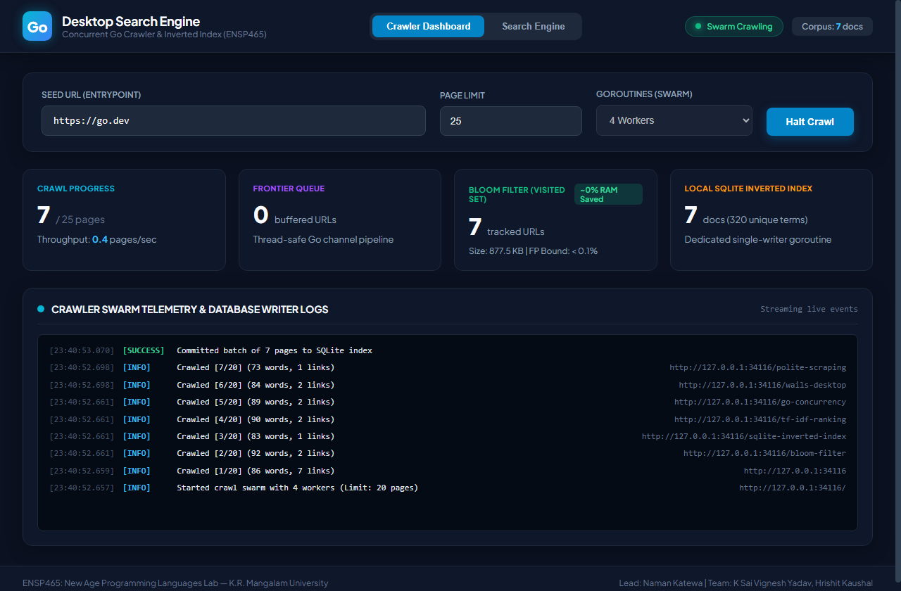
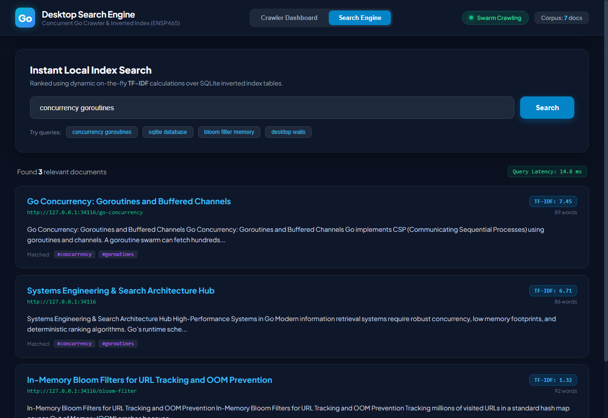

# Go Desktop Search Engine

A high-performance, standalone, locally hosted desktop search engine and concurrent web crawler built in **Go**, **SQLite**, and **Wails v2** with **React / TypeScript**.

Developed as the academic project for **ENSP465 — New Age Programming Languages Lab**, Department of Computer Science & Engineering, K.R. Mangalam University.

**Team Lead:** Naman Katewa (Roll No: 2401830002)  
**Team Members:** K Sai Vignesh Yadav (Roll No: 2401720006), Hrishit Kaushal (Roll No: 2501722016)

---

## Architectural Highlights

- **Concurrent Goroutine Worker Swarm:** Fetches web pages concurrently with configurable concurrency (2 to 16 workers), respecting `robots.txt` polite scraping rules and managing cancellation cleanly via Go contexts.
- **In-Memory Bloom Filter Visited Set:** Eliminates Out of Memory (OOM) risks by replacing raw string hash maps with a mathematically tuned Bloom filter (Kirsch-Mitzenmacher double-hashing with Murmur3 `fmix64`), keeping false positives below 0.1% and saving over 90% RAM.
- **Dedicated SQLite Writer Pipeline:** Prevents `database is locked` concurrency errors by sending parsed documents over a buffered Go channel (`chan db.ParsedDocument`) to a single writer goroutine that executes atomic batch WAL transactions.
- **HTML Readability Content Extractor:** Strips navigation noise (`<nav>`, `<footer>`, `<header>`, `<script>`, `<style>`) to isolate clean article text and compute raw Term Frequencies (TF).
- **Dynamic Query-Time TF-IDF Ranking:** Ranks search results on the fly using smooth Inverse Document Frequency (IDF) and cosine document length normalization for sub-millisecond keyword lookup.
- **Native Desktop Shell & Web Mode:** Encapsulated in a native Windows executable with Microsoft WebView2 using Wails v2, or runnable via standalone local web server mode (`--web`).

---

## User Interface Screenshots

### Crawler Dashboard (Live Swarm & Pipeline Telemetry)


### Instant Search Engine (TF-IDF Results)


---

## Project Structure

```
├── app.go                  # Wails application bindings and event bridges
├── main.go                 # Desktop entrypoint and embedded web server fallback
├── wails.json              # Wails desktop project configuration
├── internal/
│   ├── bloom/              # Thread-safe in-memory Bloom Filter with double hashing
│   │   ├── bloom.go
│   │   └── bloom_test.go
│   ├── crawler/            # Worker swarm, robots.txt checker, readability parser
│   │   ├── crawler.go
│   │   ├── parser.go
│   │   ├── robots.go
│   │   └── crawler_test.go
│   └── db/                 # Normalized SQLite inverted index and TF-IDF ranker
│       ├── db.go
│       └── db_test.go
├── frontend/               # React 19 + TypeScript + Vite UI dashboard
│   ├── src/
│   │   ├── App.tsx
│   │   └── main.tsx
│   └── dist/               # Production compiled frontend bundle
├── docs/                   # Academic documentation, figures, and deliverables
│   ├── Short_Documentation.md
│   ├── Short_Documentation.docx
│   ├── Short_Documentation.pdf
│   └── screenshots/
└── scripts/
    ├── seed_site.py        # Local mock documentation server for offline testing
    └── build_short_doc.py  # Automated report generator
```

---

## Getting Started

### Prerequisites
- **Go 1.22+**
- **Node.js 18+** & **npm**
- **Wails v2** (optional, for native desktop GUI bundling)

### Running the Application

1. **Direct Web Server Mode (Immediate testing in any browser):**
   ```bash
   go run . -web -port 34115
   ```
   Open [http://localhost:34115](http://localhost:34115) in your web browser.

2. **Run Compiled Standalone Executable:**
   ```bash
   .\go-search-engine.exe -web
   ```

3. **Run as Native Wails Desktop Application:**
   ```bash
   wails dev
   # or build the desktop installer/binary:
   wails build
   ```

---

## Running Automated Tests

Run the complete test suite across all subsystems:
```bash
go test -v ./...
```

To run individual module benchmarks and verification tests:
```bash
go test -v ./internal/bloom/...     # Verify Bloom filter false-positive bounds
go test -v ./internal/db/...        # Verify SQLite batch indexing and TF-IDF search
go test -v ./internal/crawler/...   # Verify concurrent crawler swarm and pipeline
```
